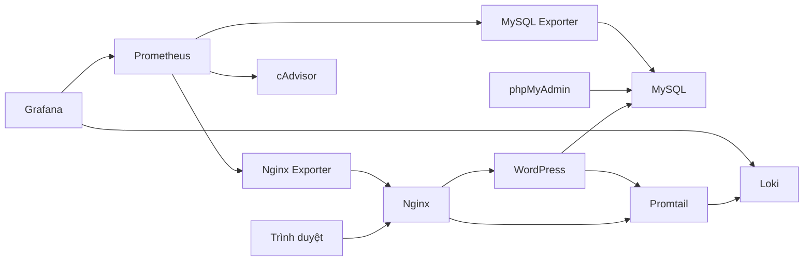

# Aurora — Website quảng bá sản phẩm

**Đề 3 · Triển khai và Quản trị Hệ thống Phần mềm**

Ngô Thị Như Quỳnh · DTC245200620 · CNTT K23D · Giảng viên Vũ Việt Dũng.

Website Aurora chạy bằng WordPress + MySQL, qua Nginx reverse proxy. Quản trị sản phẩm bằng WordPress Admin và database bằng phpMyAdmin; Prometheus/Grafana giám sát CPU/RAM container, web server và database; Loki/Promtail tập trung log.

## Chạy trên Docker Desktop

Cài Git, Docker Desktop chạy Linux containers, Docker Compose v2 và PowerShell 5.1 trở lên. Chuẩn bị khoảng 8 GB RAM và 15 GB đĩa trống.

```powershell
git clone https://github.com/DTC245200620/de3-aurora-website-quang-ba-san-pham.git
cd de3-aurora-website-quang-ba-san-pham
powershell -ExecutionPolicy Bypass -File scripts/start.ps1
powershell -ExecutionPolicy Bypass -File scripts/verify.ps1
```

Lần đầu sinh secret ngẫu nhiên. Chạy lại giữ secret và dữ liệu, không nhân bản hoặc ghi đè sản phẩm đã chỉnh sửa. Các tác vụ init hoàn thành với Exited (0) là trạng thái bình thường.

| Thành phần | Truy cập | Tài khoản |
|---|---|---|
| Website | http://localhost:8080 | Công khai trên máy local |
| WordPress Admin | http://localhost:8080/wp-admin/ | aurora_admin |
| phpMyAdmin | http://localhost:8081 | aurora |
| Grafana | http://localhost:3002 | admin |
| Prometheus | http://localhost:9092 | Local |

Mật khẩu tương ứng nằm ở `.local/secrets/wp_password`, `db_password`, `grafana_password`. Không commit, chụp hoặc chia sẻ các file này.

## Chức năng Aurora

Trang chủ, danh sách/chi tiết sản phẩm, giới thiệu và liên hệ; giao diện trắng/xanh ngọc responsive. Sáu sản phẩm mẫu gồm bình giữ nhiệt, tai nghe, sạc, bàn phím, chuột và loa. Admin thêm/sửa/xóa nội dung, giá, SKU và ảnh qua Media Library. Nội dung được lưu trong MySQL, ảnh tải lên nằm trong volume WordPress.

## Kiến trúc



Mạng database và monitoring là internal. MySQL, WordPress, Loki và exporter không publish cổng host. Cổng công cụ chỉ bind loopback.

## Vận hành

```powershell
./scripts/backup.ps1
./scripts/restore.ps1 -BackupId TEN_THU_MUC_BACKUP
./scripts/stop.ps1
```

Restore yêu cầu nhập `RESTORE`. Dừng giữ named volume của project `aurora-de3`; không dùng prune hoặc down --volumes khi chỉ muốn dừng. Backup gồm database và uploads, có checksum.

## Metrics và log

Grafana tự nạp datasource Prometheus/Loki và hai dashboard trong thư mục Aurora. Prometheus có bốn job: prometheus, containers, nginx, mysql. CPU/RAM được lấy từ cAdvisor và lọc nhãn project. Đợi hai lượt scrape trước khi xem biểu đồ.

Nginx ghi JSON access log; plugin ghi sự kiện ứng dụng. Promtail đọc log bằng mount chỉ đọc và lưu positions; Loki giữ log bảy ngày.

```logql
{project="aurora-de3",service="nginx",stream="access"} | json
{project="aurora-de3",service="nginx",stream="access"} | json | status >= 400
{project="aurora-de3",service="wordpress",stream="events"} | json | event="login_failed"
```

## Source và phiên bản

- `app/`: theme Aurora và plugin sản phẩm độc lập.
- `infra/`: cấu hình Nginx, MySQL, PHP, init và backup/restore.
- `observability/`: Prometheus, dashboard Grafana, Loki và Promtail.
- `scripts/`: script PowerShell và shell.
- `docs/`: vận hành, demo, minh chứng và báo cáo.
- `.local/`: secret và backup ngoài Git.

Compose được tách thành ứng dụng, monitoring, logging và tools. Script ghép các file này cùng `compose.lock.yaml` để chạy image theo digest cố định. Nginx, Grafana, Prometheus, Loki, Promtail và exporter dùng non-root; cấu hình read-only, capabilities và quyền riêng được giải thích trong tài liệu vận hành.

## Tài liệu

- [Docker Engine riêng trong Ubuntu WSL2](docs/WSL.md)
- [Vận hành và xử lý lỗi](docs/OPERATIONS.md)
- [Kịch bản demo và LogQL](docs/DEMO.md)
- [Kết quả nghiệm thu](docs/verification.md)
- [Báo cáo Word](docs/report/Bao_Cao_Aurora_DTC245200620.docx)

Ý tưởng tổ chức code và observability tham khảo [repo đặt vé đề 11](https://github.com/dtc245200604/dtc245200604-de11-dat-ve-xem-phim). Nguồn ảnh độc lập được ghi trong [SOURCES.md](app/plugins/aurora-products/assets/SOURCES.md).
